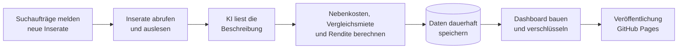

# Garagenmarkt München

Interaktives Dashboard zu Kaufangeboten für Garagen und Tiefgaragen-Stellplätze in München
und im Landkreis München.

**Zugang über Link.** Die Seite ist passwortgeschützt: https://garagen-analytics.github.io/garagen-dashboard/
Mit einem Zugangslink öffnet sie sich direkt, sonst fragt sie nach dem Passwort.

## Was das Projekt macht

- **Automatische Erfassung**: Neue Kaufangebote für Garagen und Stellplätze in München werden
  zweimal täglich automatisch erfasst und dauerhaft gespeichert, auch wenn ein Inserat später
  offline geht. Preisänderungen bleiben erhalten.
- **Bewertung mit Renditen**: Für jedes Angebot werden Kaufnebenkosten, Gesamtinvestition,
  Rendite brutto und Rendite netto berechnet. Eine KI überführt die freie Beschreibung in
  einheitliche Angaben (z. B. Objektart, Hausgeld).
- **Vergleichsmiete aus Mietangeboten**: Die erwartbare Miete stammt aus Mietangeboten in der
  Umgebung (unteres Quartil, Ausreißer entfernt). Das Dashboard zeigt für jedes Objekt, welche
  Angebote in die Vergleichsmiete eingehen.
- **Dashboard**: Karte, Filter, Kennzahlen, Rechenweg je Objekt und Streudiagramm, auf Deutsch
  und Englisch.

## Ablauf

Läuft automatisch zweimal täglich in der Cloud. Dieses Repository enthält nur die fertige,
verschlüsselte Seite; es wird bei jeder Aktualisierung ersetzt (keine Datenhistorie).

## Technik

Python · GitHub Actions (zeitgesteuert) · E-Mail-Auswertung · HTML-Parsing · Google Gemini
(strukturierte Ausgabe) · Kennzahlen und Vergleichsmiete (Umkreissuche, Quartile) ·
MapLibre GL JS mit OpenFreeMap · eigene SVG-Diagramme · StatiCrypt (AES, Entschlüsselung im
Browser) · GitHub Pages

## English summary

Interactive dashboard of garage and parking space offers for sale in Munich and the Munich
district. Listings are collected automatically twice a day and stored permanently; each offer is
rated with gross and net yield, and the expected rent is derived from rental offers nearby. The
page shows a map, filters, key figures, the calculation for each property and a scatter chart
(German and English).

**Access via link.** The page is password-protected: https://garagen-analytics.github.io/garagen-dashboard/
A link with access opens it directly; otherwise it asks for the password.

Tech: Python, GitHub Actions, Google Gemini, MapLibre GL JS, SVG charts, StatiCrypt, GitHub Pages.
